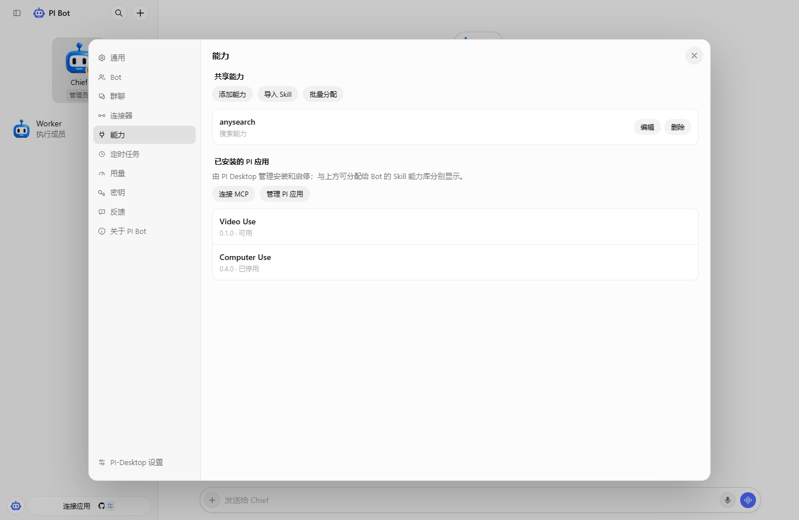

<div align="center">
  
  <h1>PI Bot</h1>
  <p>在 PI Desktop 中，让一组长期协作的 Bot 一起工作。</p>
  <p>
    <a href="https://github.com/vsd269/PI-Bot/releases"></a>
    <a href="https://github.com/vsd269/PI-Bot/actions/workflows/ci.yml"></a>
    <a href="LICENSE"></a>
  </p>
  <p>简体中文 · <a href="README.en.md">English</a></p>
</div>

PI Bot 是基于 [DeepSeek-Bot](https://github.com/Fei2411/DeepSeek-Bot) 学习、迁移和持续调整的 **PI Desktop 适配项目**。项目保留上游的 Bot 团队、群聊协作等设计思路，并将运行、工具、权限和界面接入 PI Desktop 的插件接口。

感谢原作者的开源工作。本项目是独立维护的衍生适配版，不是 DeepSeek-Bot 的官方发行版，也不声称所有能力与上游完全一致。

## 可以做什么

| 能力 | 说明 |
| --- | --- |
| 私聊与团队协作 | 多 Bot 私聊、群聊、管理员派发任务，执行成员可按群聊串行或并行工作 |
| 流式消息 | 接收过程中的文字更新，支持消息引用、局部文字选择、聊天查找与历史搜索 |
| 长期记忆 | 每 Bot 的文件化记忆、自动提取、查看和维护；自动提取会调用模型 |
| Skill 与能力包 | 导入本地 Skill，管理共享能力，并批量分配给指定 Bot |
| 应用与 MCP | GitHub 连接器，以及按 Bot 配置和授权的本地或远程 MCP；Notion 提供配置入口 |
| 语音 | 语音输入、实时转写对话、麦克风选择和状态波形；云服务需自行配置 |
| 本地工作流 | 定时任务、任务恢复入口、浏览器工具、用量与备份管理 |
| 界面 | 明暗模式、主题、自定义头像和会话侧栏 |

## 界面预览



演示界面使用虚构 Bot 与测试目录，不代表已连接外部服务。

## 安装

1. 安装 [PI Desktop](https://github.com/vsd269/PI-Desktop)，配置可用的模型。
2. 从 [Releases](https://github.com/vsd269/PI-Bot/releases/latest) 下载 `PI-bot-版本号.piplug`。
3. 在 PI Desktop 的插件管理页选择从本地安装插件包，检查并授予所需权限。
4. 重启 PI Desktop，打开 **PI Bot**，创建 Bot 和群聊。

插件声明的最低接口版本为 PI Desktop **0.18.0**；本次安装包在 Windows 的 **0.20.1 原生安装器**上做过隔离安装校验。Windows 是主要开发和验证平台，其他平台尚未进行完整验证。

升级安装使用同一个插件 ID `local.ds-bot`，以延续现有数据。建议升级前使用插件内的备份功能。安装包不携带作者的 Bot、聊天、密钥或个人配置。

## 使用与边界

- **模型**：使用你在 PI Desktop 中配置的模型和账号，不附带模型额度。
- **语音**：语音输入用于录音后转写，语音对话可使用实时识别。服务商、模型、密钥和费用需自行配置；朗读可用系统语音或配置的服务。识别、打断和降噪效果受设备及服务影响。
- **连接器**：GitHub 使用令牌连接；Notion、邮箱等需要相应 MCP 服务及账号授权。配置入口不等于已经完成服务接入。详见 [连接器说明](CONNECTORS.md)。
- **定时任务**：依赖 PI Desktop 运行、插件启用和相应工作区；不是独立的云端调度服务。
- **任务恢复**：依据已保存会话核对、继续或重试；不保证任意工具执行中途无损恢复。
- **权限与数据**：原生工具继续受 PI Desktop 会话权限控制。本地 MCP 可运行你授权的程序。Windows 密钥使用当前用户加密，跨电脑须单独加密导出；不要把团队备份发布到 GitHub。

## 本地构建

需要 Node.js **20+** 和 Git。构建与下列测试不需要安装 npm 依赖。

```powershell
git clone https://github.com/vsd269/PI-Bot.git
cd PI-Bot
npm run check
npm test
npm run package
npm run verify:package
```

产物位于 `dist/PI-bot-版本号.piplug`，校验值位于 `dist/SHA256SUMS.txt`。`.piplug` 使用 PI 安装器需要的 ZIP STORE 格式；不要直接改用普通压缩包代替。

```text
renderer/   插件界面、交互与来源记录
src/        团队、Agent、记忆、能力及平台适配
scripts/    语法检查、打包和包校验
tests/      使用测试数据的功能回归
manifest.json  PI Desktop 插件声明
```

## 验证与反馈

本仓库提供无需真实账号的回归测试和 Windows CI。语音、模型、OAuth、浏览器与原生工具的真实效果仍需要在自己的配置中验证；测试通过不代表没有缺陷。

问题请提交到 [PI Bot Issues](https://github.com/vsd269/PI-Bot/issues)，附版本、复现步骤和脱敏后的截图。使用方式见 [CONTRIBUTING.md](CONTRIBUTING.md)，安全问题见 [SECURITY.md](SECURITY.md)，版本变化见 [CHANGELOG.md](CHANGELOG.md)。

## 致谢与许可证

- 上游项目：[Fei2411 / DeepSeek-Bot](https://github.com/Fei2411/DeepSeek-Bot)，历史来源与移植记录保存在 [NOTICE](NOTICE) 和 [provenance.json](renderer/upstream/provenance.json)。
- 宿主客户端：[PI Desktop](https://github.com/vsd269/PI-Desktop)。本仓库不包含或修改其客户端二进制。
- 随包收录的 `ws` 使用 MIT 许可证，见 [依赖许可证](src/vendor/ws/LICENSE)。
- PI Bot 随附用户提供的头像素材；保留原有素材与第三方来源说明，不主张对第三方商标或标识的权利。

代码按 [Apache License 2.0](LICENSE) 发布，保留上游版权、署名与许可证。欢迎以学习、交流和改进适配为目的参与贡献。
