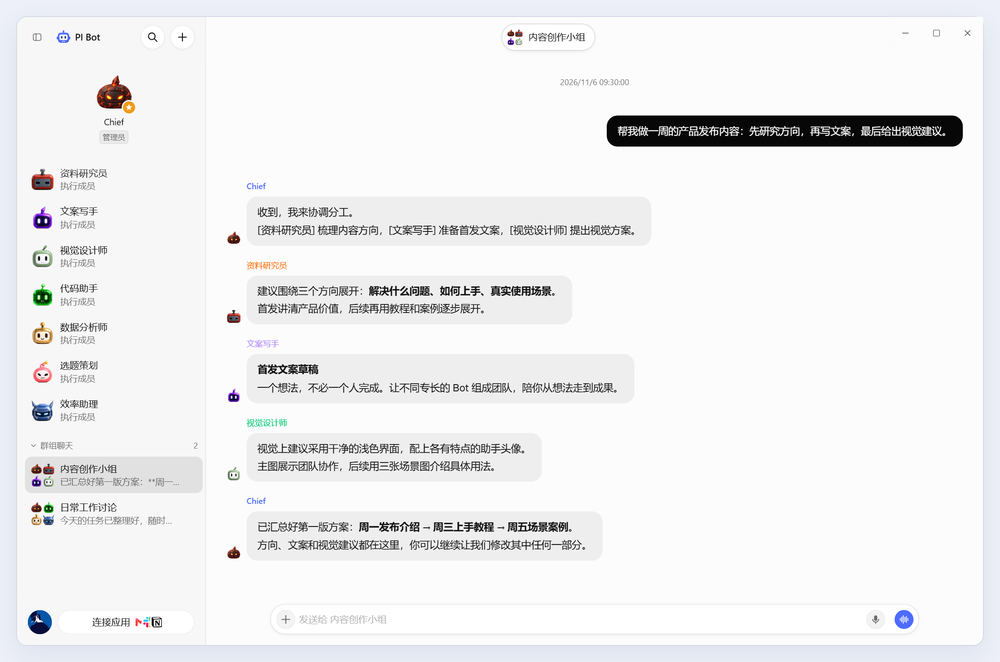
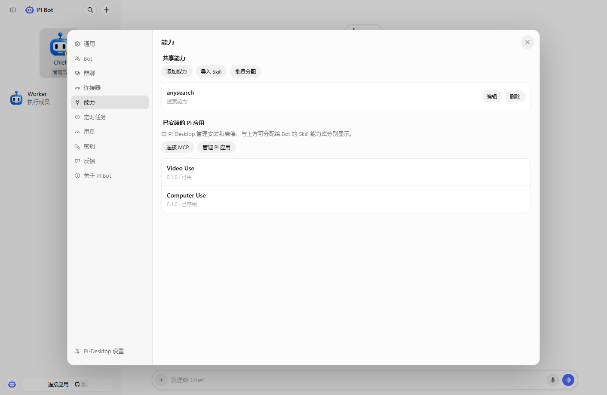

<div align="center">
  
  <h1>PI Bot</h1>
  <p>在 PI Desktop 中，让一组长期协作的 Bot 一起工作。</p>
  <p>
    <a href="https://github.com/vsd269/PI-Bot/releases"></a>
    <a href="https://github.com/vsd269/PI-Bot/actions/workflows/ci.yml"></a>
    <a href="LICENSE"></a>
  </p>
  <p>简体中文 · <a href="README.en.md">English</a></p>
</div>

PI Bot 是基于 [DS Bot](https://github.com/Fei2411/DeepSeek-Bot) 学习、迁移和持续调整的 **PI Desktop 适配项目**。项目保留上游的 Bot 团队、群聊协作等设计思路，并将运行、工具、权限和界面接入 PI Desktop 的插件接口。

感谢 DS Bot 原作者的开源工作。本项目是独立维护的衍生适配版，不是 DS Bot 的官方发行版，也不声称所有能力与上游完全一致。

<p align="center">
  
</p>
<p align="center"><sub>真实插件界面 · 模拟聊天示例：让不同专长的 Bot 在同一个群聊中一起工作。</sub></p>

最新正式版本为 **0.3.107**，汇总 0.3.102～0.3.107 的优化。完整内容见 [合并更新说明](docs/RELEASE-0.3.107.md)，安装包见 [GitHub Releases](https://github.com/vsd269/PI-Bot/releases/latest)。

## 0.3.107 更新：侧栏分类、记忆检索与聊天体验

新增群组聊天分类和自定义部门，支持拖动排序、跨部门移动及悬停菜单。长期记忆先检索索引、再按需读取正文，历史消息支持前后文回看；表情即时反馈，补齐私聊停止按钮并修复重复运行状态。优化透明渐变顶栏、侧栏渐隐与滚动条显示。详见 [本版说明](docs/RELEASE-0.3.107.md)。

## 0.3.101 更新：消息阅读与实时反馈

发送后的图片自动显示预览，点击可放大。新增消息分隔线、易读工具记录和真实工作状态；支持选中文字引用，右键菜单的七项文字操作随 PI Desktop 中英文和系统语言切换。修复右侧头像底板与设置页重复身份区域，放大消息操作按钮。详见 [本版说明](docs/RELEASE-0.3.101.md)。

## 0.3.100 更新：右侧资料库与头像取景

直接点击右侧头像和名字即可修改；上传头像新增缩放、上下位置与形状选择，调整后仍可重新取景。右侧分为详情、资料库和电脑，记忆／技能／工作文件夹集中管理，工作区与终端移入电脑页。详见 [本版说明](docs/RELEASE-0.3.100.md)。

## 0.3.99 更新：通话浮条与持久开场卡片

未回答的开场卡片会在切换聊天后保留；新增紧凑通话浮条和可展开文字记录，优化实时语音输入，收纳工作经验菜单，并补全表格搜索、复制、下载和放大查看。详见 [本版说明](docs/RELEASE-0.3.99.md)。

## 0.3.96 更新：开场问候、附件传递与输入区

新建 Bot 即时展示问候和选项卡，统一卡片与详情栏工具按钮。附件立即显示完整比例预览，补齐群聊和规划模式管理员私聊的图片／文件传递，调整输入区、顶部间距与工作区边缘。读图仍取决于所选模型的视觉能力。详见 [本版说明](docs/RELEASE-0.3.96.md)。

## 0.3.95 更新：界面细节与个人头像

对齐顶部、连接应用和详情栏按钮的尺寸、间距及卡片背景。设置 → 通用新增自定义侧栏头像；消息操作旁显示 Geist 字体的时间。详见 [本版说明](docs/RELEASE-0.3.95.md)。

## 0.3.94 更新：应用连接提示与伸缩分隔条修复

修复应用授权检查反复报错、错误残留在聊天区，以及侧栏悬停粗线问题。详见 [本版说明](docs/RELEASE-0.3.94.md)。

## 0.3.93 更新：应用连接与侧栏修复

本次合并发布 0.3.91～0.3.93；[完整更新说明](docs/GITHUB-RELEASE-0.3.93.md)。修复 [Issue #1](https://github.com/vsd269/PI-Bot/issues/1)，感谢 [@royrao2007](https://github.com/royrao2007) 的详细报告与建议。

左下角“连接应用”新增分类分组、真实应用图标、搜索与分页。每位用户填写自己的 Composio 项目密钥，通过官方页面授权，再分配给多个指定 Bot 或全部 Bot；密钥和项目配置使用本机 Windows 加密库保存。项目额度和第三方服务费用由用户自己的账号承担。

保留 GitHub PAT 与本地/远程 MCP；修复侧栏宽度拖动、展开收起过渡和顶栏拖窗区域。真实第三方账号仍需用户完成授权联调，目录卡片不代表已连接。详见 [0.3.93 使用方式与范围](docs/RELEASE-0.3.93.md)。

## 0.3.91 更新：任务分派修复与执行追踪

修复管理员重复分派、JSON 换行导致的任务失败；补充执行全过程记录、文件条件等待、原话记忆校验、工作摘要和团队配置模板，并减少无变化时的后台开销。

- **定时任务与文件等待**：设置 → 定时任务。文件等待只支持工作目录内的本地普通文件，需要 PI Desktop 保持运行。
- **工作摘要与重复失败提示**：设置 → 待处理。摘要明确区分已观察记录和未独立核对内容。
- **团队模板**：设置 → 关于 PI Bot → PI 扩展 → 备份与恢复。导入前先预览；任务默认暂停，技能不自动分配，授权和目录重新配置。
- **记忆原话**：Bot／群聊记忆面板。自动条目可显示支持原话；旧条目不补造证据。

详细边界见 [0.3.91 说明](docs/RELEASE-0.3.91.md)。真实 PI Desktop 和真实模型联调需安装新版后核对。

## 0.3.90 更新：可靠续跑与待处理

本版进一步补强“先保存、后执行”：多人任务按批次回收，用户问题及回答续跑纳入同一批次，提交结果不确定时保留记录并提示核对。设置中新增 **待处理**，集中查看问题、原生审批入口、运行异常及已完成待查看的回合。

增加状态文件外部修改保护，避免多个写入者覆盖团队名单；记忆整理逐项容错，历史用量分批补扫。普通问候不增加回收模型调用；实际任务的结果回收会使用管理员所选模型并计入用量。

群聊工作时，原发送键切换为方块停止键，可直接停止本群。正常任务取消固定交接次数上限，仅对连续无工具操作的确认或重复内容暂停并保留待办。工作经验标题与复盘按钮紧邻排列。

本地回归 284 项：283 通过、1 项因 Windows 符号链接权限跳过、0 失败；另通过待处理、上游功能/布局、私密设置和附件 UI 测试。真实 PI Desktop、真实模型及系统断电恢复未在本轮验收。入口和边界见 [0.3.90 说明](docs/RELEASE-0.3.90.md)。

## 0.3.89 更新：执行可靠性、工作经验与私密 Bot

本次合并 0.3.87～0.3.89 的改动：任务派发接收确认与重启核对、执行状态记录、群聊全部停止、用户确认的 Skill/项目规则提案、可拖动响应式侧栏、轻量 Office 工具，以及插件层私密 Bot。

- **执行记录**：设置 → 关于 → PI 扩展 → 任务恢复中心；不会自动重派结果未知的任务。
- **群聊全部停止**：点击群聊标题 → 群详情 → 全部停止。
- **经验复盘**：Bot 私聊 → 复盘经验 → 查看并确认；自动复盘在通用设置中开启，默认关闭。
- **Office 工具**：通用设置 → Office 文档 → 检查 Office 环境；需要独立 Node.js 20+。
- **私密 Bot**：选择普通 Bot → 点击顶部名称 → 编辑会话 → 隐私。需独立工作目录且不能加入群聊；这是插件层保护，原生文件、命令、MCP 等仍受宿主权限控制，并非系统级沙箱。

完整三次更新说明见 [0.3.89 发布说明](docs/GITHUB-RELEASE-0.3.89.md)，私密功能细节见 [使用说明](docs/RELEASE-0.3.89.md)。本地回归 238 项：237 通过、1 项因 Windows 符号链接权限跳过；真实宿主及模型联调不在本次自动化覆盖范围内。

## 0.3.86 新功能

新增共享头像库、`/side` 侧问别名、已结束侧问删除、Bot 队列未读提示，以及 `message_bot` 请求编号去重。入口、迁移范围与限制见 [0.3.86 版本说明](docs/RELEASE-0.3.86.md)。

## 可以做什么

| 能力 | 说明 |
| --- | --- |
| 私聊与团队协作 | 多 Bot 私聊、群聊、管理员派发任务，执行成员可按群聊串行或并行工作 |
| 流式消息 | 接收过程中的文字更新，支持消息引用、局部文字选择、聊天查找与历史搜索 |
| 长期记忆 | 每 Bot 及每个群聊独立的文件化记忆、自动提取、查看和维护；自动提取会调用模型 |
| 交互卡片 | 文本、指标、表格、五类图表、公式计算器、滑块和静态隔离 HTML；支持选项/确认/表单交回答案，需模型支持工具调用 |
| 独立侧问 | 私聊输入 `/btw 问题`，不打断主任务、不执行工具、不写入主上下文；使用模型并计入用量 |
| 消息时间 | 显示本机时区的消息时间与已有记录中的 Bot 回复耗时 |
| Skill 与能力包 | 导入本地 Skill，管理共享能力，并批量分配给指定 Bot |
| 应用与 MCP | 自有 Composio 项目的应用连接、搜索与 Bot 分配；保留 GitHub PAT 与本地/远程 MCP |
| 语音 | 语音输入、实时转写对话、麦克风选择和状态波形；云服务需自行配置 |
| 本地工作流 | 定时任务、任务恢复入口、浏览器工具、用量与备份管理 |
| 界面 | 明暗模式、气泡/平铺、消息宽度、思考显示、自定义头像和会话侧栏 |

上一版的 `/btw` 侧问、图表与本地计算卡片、群内文字交接暂停/继续、外观设置及密钥用途备注见 [0.3.85 版本说明](docs/RELEASE-0.3.85.md)。HTML 仅静态隔离展示，取消侧问不保证中断宿主底层模型请求。

## 界面预览

0.3.82 新功能入口与示例见 [版本说明](docs/RELEASE-0.3.82.md)：群详情中的“群聊记忆”、消息旁的时间/耗时，以及私聊中的 `show_view` 交互卡片。



演示界面使用虚构 Bot 与测试目录，不代表已连接外部服务。

## 安装

1. 安装 [PI Desktop](https://github.com/vsd269/PI-Desktop)，配置可用的模型。
2. 从 [Releases](https://github.com/vsd269/PI-Bot/releases/latest) 下载 `local.pi-bot-版本号.piplug`。
3. 在 PI Desktop 的插件管理页选择从本地安装插件包，检查并授予所需权限。
4. 重启 PI Desktop，打开 **PI Bot**，创建 Bot 和群聊。

插件声明的最低接口版本为 PI Desktop **0.18.0**；安装包通过 Windows PI Desktop 原生安装器的临时数据目录校验（本版结果见版本交付记录）。Windows 是主要开发和验证平台，其他平台尚未进行完整验证。

从 **0.3.81** 起，插件 ID 和正式包名统一使用 **`local.pi-bot`**，界面名称为 **PI Bot**。从 0.3.80 或更早版本升级：

1. 在 PI Desktop 插件管理中先**停用旧版 PI Bot**，暂不要卸载。
2. 导入 `local.pi-bot-版本号.piplug`，授予权限并重启。
3. 首次启动自动复制旧 Bot、群聊、聊天、记忆、Skill、上传附件、浏览器资料和同一 Windows 用户的加密密钥，并保留旧数据。新版已有团队或备份时不会再次导入旧数据。
4. 确认新版正常后，可继续保留停用的旧版。完整备份仍建议保留。

迁移只处理当前 PI 数据根目录下已知的旧插件目录，不扫描其他用户资料。迁移先在临时目录验证完整性，再提交；中断后可重试，不合并或覆盖已有新团队。两个版本同时启用时，新版会提示先停用旧版，以免重复执行任务。安装包不携带作者的 Bot、聊天或密钥。

## 接收新版本提醒

从 **0.3.79** 起，打开 PI Bot 后会在后台检查本仓库的正式 GitHub Release。发现新版时，侧栏显示提醒；在「设置 → 关于」可手动检查、查看发布说明并下载插件包，也可关闭自动检查。

更新流程是 **收到提醒 → 下载 .piplug → 在 PI Desktop 插件管理中导入 → 重启**，不会静默替换运行中的插件。0.3.78 及更早版本需要先手动安装一次带检查功能的版本。自动检查只在 PI Bot 页面运行时进行，正常结果缓存 6 小时；离线或 GitHub 限流时不会误报“已是最新”。检查只访问公开 Releases API，不使用用户的 GitHub 连接器令牌。

维护者发布时，`manifest.json`、`package.json`、Git 标签和包名需对应同一个更高版本；创建 **非草稿、非预发布** 的 Release，并附上 `local.pi-bot-X.Y.Z.piplug`。仅推送源码或创建没有安装包的标签不会触发可安装更新提示。

上传插件中心时，选择 `local.pi-bot-版本号.piplug`，文件名必须与插件 ID 和版本一致。GitHub 同时保留内容相同的 `PI-bot-版本号.piplug` 兼容附件，供 0.3.79 的更新检测使用；它不用于插件中心上传。关于页名称仍为 PI Bot，安装 ID 不变。

`npm run preflight:market` 对照已遇到的文件名和动态导入提示做本地检查，不代表已经通过平台完整审核。

## 使用与边界

- **模型**：使用你在 PI Desktop 中配置的模型和账号，不附带模型额度。
- **语音**：语音输入用于录音后转写，语音对话可使用实时识别。服务商、模型、密钥和费用需自行配置；朗读可用系统语音或配置的服务。识别、打断和降噪效果受设备及服务影响。
- **连接器**：可使用自己的 Composio 项目授权应用，分配给多个 Bot；GitHub 令牌和自定义 MCP 接入继续保留。配置入口不等于已经完成服务接入。详见 [连接器说明](CONNECTORS.md)。
- **定时任务**：依赖 PI Desktop 运行、插件启用和相应工作区；不是独立的云端调度服务。
- **任务恢复**：依据已保存会话核对、继续或重试；不保证任意工具执行中途无损恢复。
- **权限与数据**：原生工具继续受 PI Desktop 会话权限控制。本地 MCP 可运行你授权的程序。Windows 密钥使用当前用户加密，跨电脑须单独加密导出；不要把团队备份发布到 GitHub。

## 本地构建

需要 Node.js **20+** 和 Git。构建与下列测试不需要安装 npm 依赖。

```powershell
git clone https://github.com/vsd269/PI-Bot.git
cd PI-Bot
npm run check
npm test
npm run package
npm run verify:package
```

产物位于 `dist/local.pi-bot-版本号.piplug`，校验值位于 `dist/SHA256SUMS.txt`。`.piplug` 使用 PI 安装器需要的 ZIP STORE 格式；不要直接改用普通压缩包代替。

```text
renderer/   插件界面、交互与来源记录
src/        团队、Agent、记忆、能力及平台适配
scripts/    语法检查、打包和包校验
tests/      使用测试数据的功能回归
manifest.json  PI Desktop 插件声明
```

## 验证与反馈

本仓库提供无需真实账号的回归测试和 Windows CI。语音、模型、OAuth、浏览器与原生工具的真实效果仍需要在自己的配置中验证；测试通过不代表没有缺陷。

问题请提交到 [PI Bot Issues](https://github.com/vsd269/PI-Bot/issues)，附版本、复现步骤和脱敏后的截图。使用方式见 [CONTRIBUTING.md](CONTRIBUTING.md)，安全问题见 [SECURITY.md](SECURITY.md)，版本变化见 [CHANGELOG.md](CHANGELOG.md)。

## 致谢与许可证

- 上游项目：[Fei2411 / DS Bot](https://github.com/Fei2411/DeepSeek-Bot)，仓库地址沿用原 URL；历史来源与移植记录保存在 [NOTICE](NOTICE) 和 [provenance.json](renderer/upstream/provenance.json)。
- 宿主客户端：[PI Desktop](https://github.com/vsd269/PI-Desktop)。本仓库不包含或修改其客户端二进制。
- 随包收录的 `ws` 使用 MIT 许可证，见 [依赖许可证](src/vendor/ws/LICENSE)。
- PI Bot 随附用户提供的头像素材；保留原有素材与第三方来源说明，不主张对第三方商标或标识的权利。

代码按 [Apache License 2.0](LICENSE) 发布，保留上游版权、署名与许可证。欢迎以学习、交流和改进适配为目的参与贡献。
